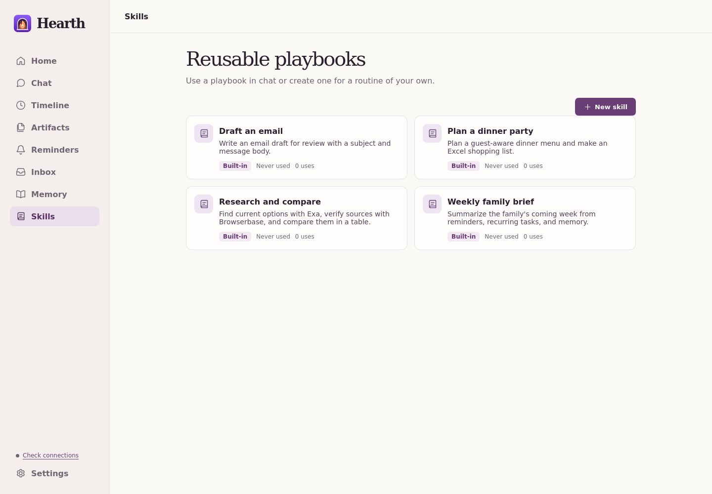
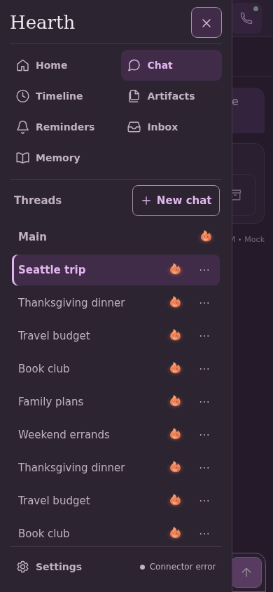
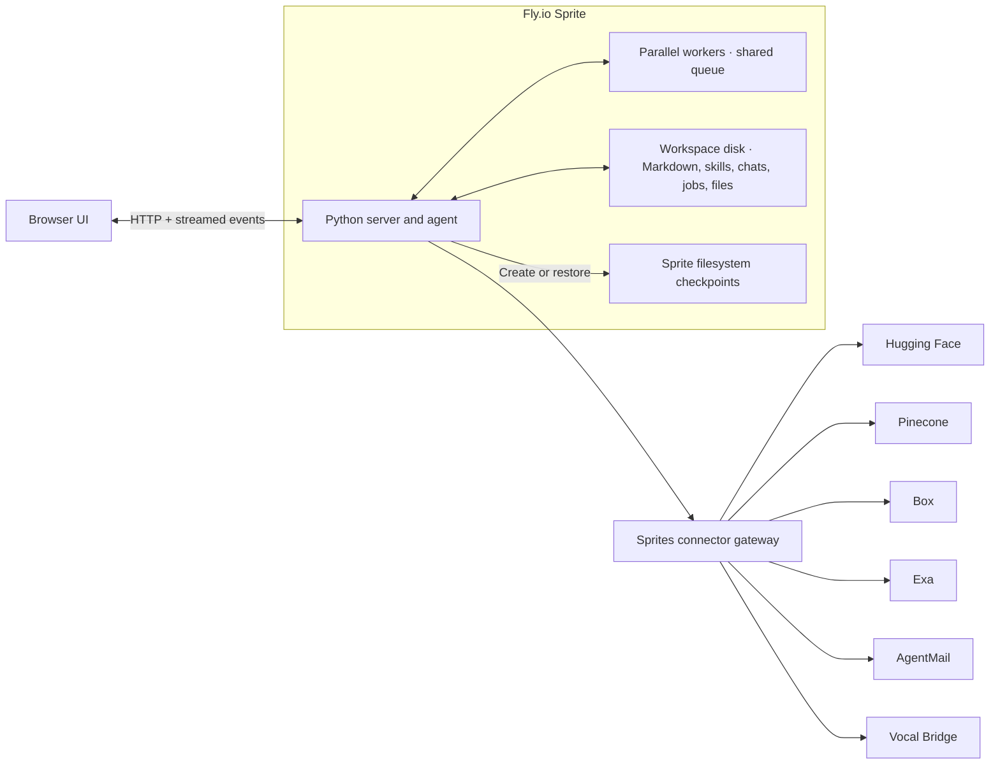

# Hearth


Hearth is a personal agent that lives on a Fly.io Sprite. Ask Ember to plan dinner, and Hearth can recall your Markdown notes, draft an invitation for approval, make a shopping spreadsheet, and schedule a reminder. The workspace stays on the Sprite across sleeps and restarts. Fly's connector gateway supplies access to models and services such as Box and Pinecone, while Timeline shows what Hearth did and which changes you can undo. Built for Fly.io Hacksgiving 2026.

## Screenshots

| Home | Chat approval | Artifacts and Pages |
| --- | --- | --- |
| [](docs/screenshots/home.png) | [](docs/screenshots/chat-approval.png) | [](docs/screenshots/artifacts-pages.png) |
| **Recurring tasks** | **Settings → Connections** | **Skills** |
| [](docs/screenshots/recurring-tasks.png) | [](docs/screenshots/connections.png) | [](docs/screenshots/skills.png) |

[](docs/screenshots/mobile-dark-drawer.png)

The screenshots use fictional data from the workspace audit. [Run 39 UI/UX audit](UX-AUDIT.md)

## Navigation

The desktop sidebar and mobile drawer list **Home**, **Chat**, **Timeline**, **Artifacts**, **Reminders**, **Inbox**, **Memory**, and **Skills** in that order. On phones, the eight links fit in a two-column grid above **Threads** and **New chat**. The drawer scrolls through longer chat lists with **Settings** pinned at the bottom.

**Settings** opens with all sections collapsed. The same accordion on desktop and phones groups preferences under **Assistant**, **Connected**, **Notifications**, and **App**. Manage and test connectors under **Connected → Connections** and review skill approval policies under **Notifications → Approvals**. Browse and edit playbooks on the **Skills** page. The `#skills` bookmark opens that page, and `#connections` opens Settings → Connections. On phones, find **Ember view** under **App → Appearance**.

## What you can do

- **Chat with Ember.** Stream replies in Main or in separate side chats. Scroll up to load older messages. If a stream drops, Chat can replace the partial bubble on refresh once the server saves the reply. The open chat announces completed replies through a polite live region. Attach images, audio, PDFs, spreadsheets, and other supported files. Use a connected model, Smart routing across a model pool, or the local Mock brain. [Chat and polling](docs/architecture.md#polling-and-chat-history)
- **Delegate independent work.** Ask a connected brain to use parallel workers for a comparison or several sources. Hearth shows progress, tool steps, and Stop controls in chat, shows active workers under **Running now** on Home, and combines their findings into one reply. Set the workspace limit from 1 to 6 in **Settings → Brain → Parallel workers**. The default is 4.
- **Get timely suggestions.** **Home → Feed** combines Exa articles, topic digests, ideas from Memory, reminder prep, and timely Action suggestions. Follow or mute topics, steer what shows up, save cards, or take a card into Chat. [Proactivity guide](docs/proactivity.md)
- **Turn suggestions into next steps.** The **Ideas** strip in Home Feed opens Chat drafts and approval cards for in-app reminders, follow-up automations, and public-page watchers. The **Goals** panel tracks target dates, check-ins, and progress from linked reminders or tasks, with goal context in Chat and Undo in Timeline. [Ideas and Goals guide](docs/ideas-and-goals.md), [Run 47 verification](docs/run-47.md)
- **Check watcher availability.** **Settings → Watchers** shows the Apify gateway blocker. Page and price watchers offered by Ideas use Hearth’s public-page reader and appear under **Reminders → Recurring tasks** after approval. [Watcher status](docs/watchers.md)
- **Stay on top of work.** Home shows reminders, Inbox, recent files, memory, activity, connector health, and Open-Meteo weather. Add panels from chat and rearrange them on Home.
- **Make files and pages.** Create and edit DOCX, PDF, XLSX, and PPTX from chat. Preview and download artifacts, keep versions locally, and optionally sync to Box. Local files and Pages remain visible while the Box listing refreshes in the background. Build single-file HTML pages with phone and desktop previews, version history, and optional approved snapshot sharing. [Artifact listings and transfers](docs/box.md#artifact-listings-and-transfers)
- **Ask your Box files.** In **Artifacts → Ask my files** or Chat, ask Hearth about selected files or up to 25 recent files. Answers cite file names with **Open in Box** links. The Sprite verified a question across a DOCX and an XLSX using Hearth’s text extraction, Pinecone, and its connected brain. [Box setup and probe](docs/box.md), [Run 46 verification](docs/run-46.md)
- **Reuse skills in chat.** Start with four built-in Markdown playbooks or write your own. Use **Try it** to preload a skill in a side chat, select **Using skill** to open its playbook, and undo edits from Timeline. [Skills guide](docs/skills.md)
- **Review actions.** Approve, edit supported fields, or decline proposed actions, including email. Timeline records tool activity and approvals. Supported changes offer item-level Undo or filesystem checkpoint restore.
- **Review what Hearth remembers.** Edit your profile and browse linked People, Places, Topics, and Daily notes. Search uses local keyword matching in English and Chinese, with optional Pinecone recall. With Auto-remember enabled, chat can save durable facts to subject notes during the turn. In chat, ask Hearth to permanently forget a specific fact. [Memory guide](docs/memory.md)
- **Consolidate memory with review.** Hearth prepares a nightly digest of duplicate entries, contradictions, repeated profile facts, and stale items. Review proposals in **Memory → Review** or from **Home → Feed**. Change the schedule or select **Run now** in **Settings → Memory**. Accepted edits can be undone in Timeline. [Memory review](docs/memory.md#nightly-memory-review)
- **Keep context in long chats.** Hearth combines the latest 16 dialogue messages with a rolling summary of earlier turns. With a connected brain, summaries update in the background. View or reset a summary from the thread’s **⋯** menu, or turn off **Summarize long chats** in **Settings → Memory**. [Long chats](docs/memory.md#long-chats)
- **Act when something happens.** Create a rule in **Settings → Automations** or ask in Chat and confirm the proposal. New AgentMail messages, reminder firings, Feed cards, and scheduled times can trigger a run. Settings shows the run history, and Timeline offers Undo for reversible changes. The inbound email path passed a live Sprite check. [Automations guide](docs/approvals-and-tasks.md#event-triggered-automations), [Run 44 verification](docs/run-44.md)
- **Run on a schedule.** Create reminders or recurring prompts with their own run history. Hearth claims due reminders separately from email delivery and journals reminder email attempts for recovery across local restores. AgentMail setup enables forwarded-mail import and configured email delivery. [Scheduler delivery and restore](docs/approvals-and-tasks.md#scheduler-delivery-and-restore)
- **Talk to Hearth.** Dictate with browser speech recognition or Hugging Face Whisper. Vocal Bridge adds live calls routed to the originating chat, with a scripted call demo available locally.

## Architecture



## Sprites connectors used

Connectors are enabled per Sprite. A fresh clone has empty connection settings and runs with Mock when no model is available. The status column describes prior checks and known gateway limits for specific operations.

| Connector | What it powers | Status |
| --- | --- | --- |
| Hugging Face | Chat, image understanding, Whisper, and dense memory embeddings | Live chat passed in Run 55 and Whisper transcription passed in Run 34. |
| Pinecone | Semantic recall, file-question retrieval, namespace sync, and optional reranking | Live file-question retrieval passed in Runs 46 and 48 using the separate `files` namespace. |
| Box | Artifact upload, version writes, and reading files from the workspace folder | Live upload and file reads passed. Box AI Ask and structured extraction returned gateway HTTP 403. [Box details](docs/box.md) |
| Exa | Web search and source links in chat | Live sourced replies passed in Runs 34 and 64. |
| AgentMail | Approved chat email, reminder and task delivery, and forwarded-mail imports | Run 44 verified the inbound automation path. Run 63 delivery checks used mocked mail. |
| Vocal Bridge | Live calls and chat queries from the voice agent | Requires a deployed voice agent and its connector. Live call verification is outside Run 63. |
| Browserbase | Search, fetch, and approval-gated browser sessions | The demo Sprite passed the read-only connection check in Run 34. |
| Ollama Cloud | Alternative chat brain through the gateway | Optional configuration. Live model verification is outside Run 63. |
| Apify | Actor-list probe | The list probe passed. Gateway HTTP 403 blocked run and dataset reads. Hearth's watchers use its public-page reader. [Apify probe](docs/watchers.md) |

[Set up connectors](docs/connectors.md)

## Quick start

Use Python 3.12, the version pinned in CI. Run from the repository root.

```sh
python3 -m venv .venv
. .venv/bin/activate
python -m pip install -r requirements.txt
python -m hearth.server
```

Open <http://127.0.0.1:8080>. A fresh local workspace seeds the sample memory and falls back to Mock. You can also pin **Mock** in **Settings → Brain**. In Chat, select **Plan Thanksgiving dinner** to try recall, approvals, reminders, and file creation. The weather card can still contact Open-Meteo in Mock mode.

To deploy, sign in with the Sprites CLI, create a private Sprite named `hearth`, and run the deploy script.

```sh
scripts/deploy.sh
```

GitHub Actions requires the unit suites, JavaScript syntax checks, and both offline Chromium checks before deploying with the `SPRITES_TOKEN` repository secret. The deployment guide covers organization selection, scheduler wake, the optional Pages publisher, and the manual signed-out edge check. [Workflow](.github/workflows/deploy.yml), [Deployment guide](docs/deploy.md)

## Configuration

Use **Settings → Connections** to refresh discovery. Other Settings sections configure the brain, recall, search, voice, reminders, proactivity, automations, approvals, and artifacts. Recurring tasks can delegate through the same pool. A skill can delegate by including `spawn_workers` and the worker tools it allows. [Connector defaults](config/connectors.json) ship with blank connection IDs. Local settings are saved under the workspace by default. The Sprite service saves connector settings under `~/hearth/config/`.

| Setting | Use |
| --- | --- |
| `HEARTH_DATA_DIR` | Workspace root, defaulting to `.hearth/` locally. |
| `HEARTH_CONNECTOR_CONFIG` | Path to a private connector settings JSON file. |
| `HEARTH_CHECKPOINTS=sprite` | Select native checkpoints inside a Sprite. Local copies are the default. |
| `HEARTH_CJK_FONT` | Path to the WenQuanYi Micro Hei font for Chinese PDF text. |

## Tests

Use Node.js 22 as in CI. Install the Chinese PDF test font using the [development guide](docs/development.md), which also covers Playwright.

```sh
python -m pip install -r requirements-test.txt
python -m unittest discover -s tests
node --test tests/*.test.mjs
for file in web/*.js; do node --check "$file" || exit; done
```

Run 63 passed 315 Python tests, 16 Node tests, JavaScript syntax checks for 27 files, and both offline Chromium runs. [Test commands and results](docs/testing.md), [Live QA and provider limitations](QA-REPORT.md)

## Project layout

| Path | Contents |
| --- | --- |
| [hearth/](hearth/) | Python server, agent tools, provider adapters, and workspace services |
| [web/](web/) | HTML, CSS, JavaScript, Ember assets, and the vendored call SDK |
| [memory/](memory/) | Sample Markdown copied into a fresh workspace |
| [config/](config/) | Connector defaults and catalog |
| [scripts/](scripts/) | Sprite deployment, services, and scheduler wake |
| [tests/](tests/) | Python, Node, and browser fixtures |

## Security and privacy

Keep the workspace URL behind Sprite authentication. Provider API keys stay with Fly and are injected by the connector gateway. The repository ships blank connection settings and ignores runtime settings and data. Hearth persists chat, memory, skills, files, approvals, and schedules on disk. Enabled providers can receive prompts, loaded playbooks, excerpts, files, or audio required for the feature. Vocal Bridge sends the browser a short-lived room credential, and an approved public Page link grants anyone holding it access to that snapshot. A filesystem restore rolls back disk state. Delivered mail and other provider-side effects can persist after an Undo.

## Documentation

- [Architecture](docs/architecture.md)
- [Connectors](docs/connectors.md)
- [Box and Ask my files](docs/box.md)
- [Deploy](docs/deploy.md)
- [Approvals and tasks](docs/approvals-and-tasks.md)
- [Feed, Action suggestions, and the Morning brief](docs/proactivity.md)
- [Memory](docs/memory.md)
- [Skills](docs/skills.md)
- [Voice](docs/voice.md)
- [Development](docs/development.md)
- [Testing and edge authorization](docs/testing.md)
- [Security and untrusted content](docs/security.md)
- [Design-review status](DESIGN-REVIEW.md#run-63-status)
- [Project status](STATUS.md) and [QA report](QA-REPORT.md)

## License

Hearth is released under the [MIT License](LICENSE). The vendored call SDK and LiveKit code retain their Apache 2.0 notices. [Vocal Bridge license](web/vendor/LICENSE-VocalBridge), [LiveKit license](web/vendor/LICENSE-LiveKit)
