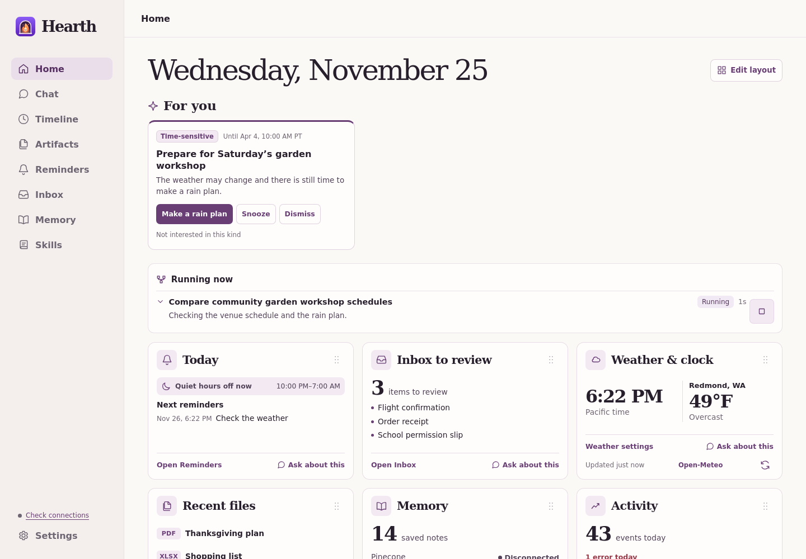
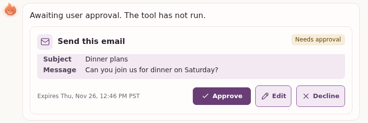
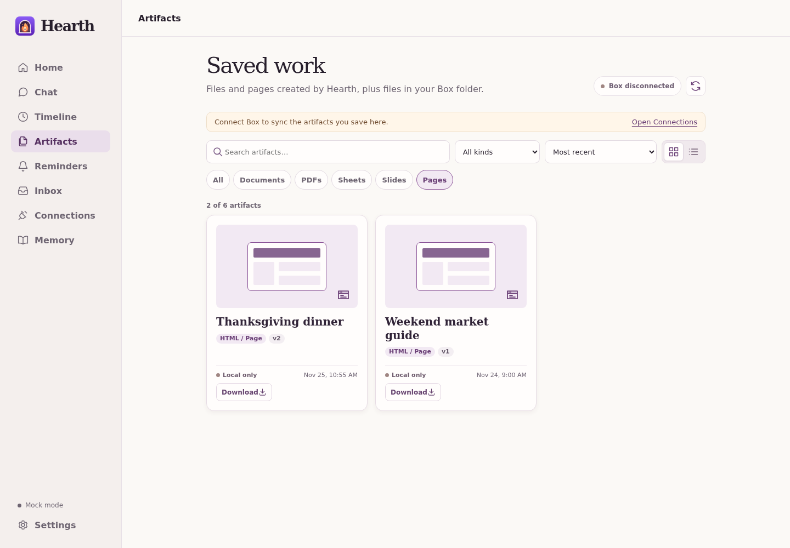
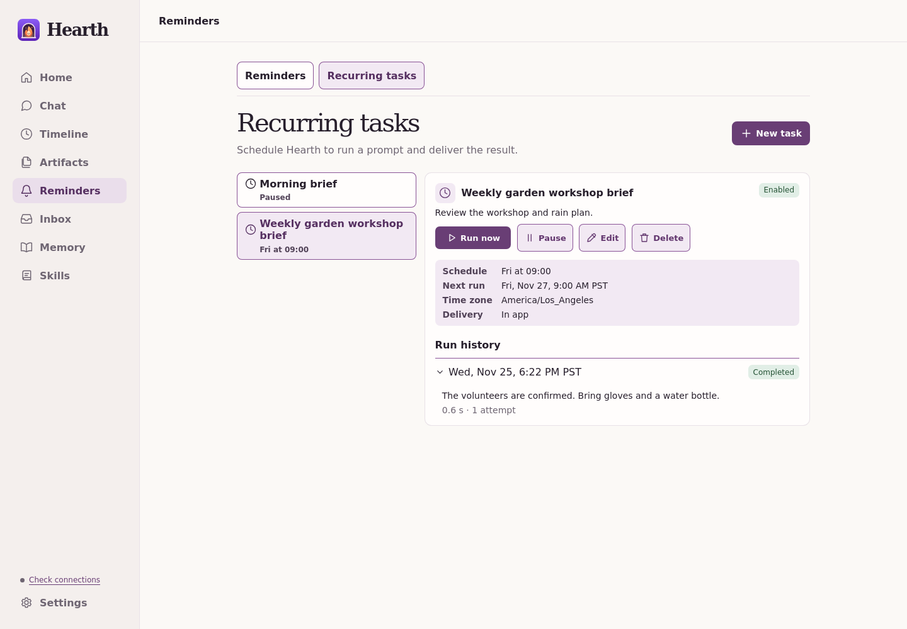
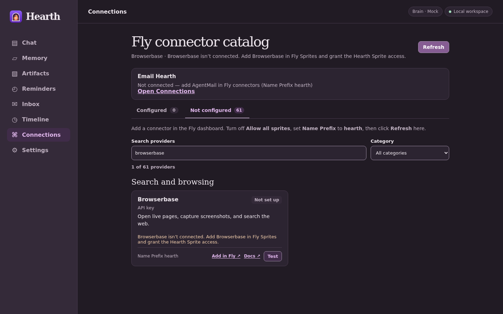
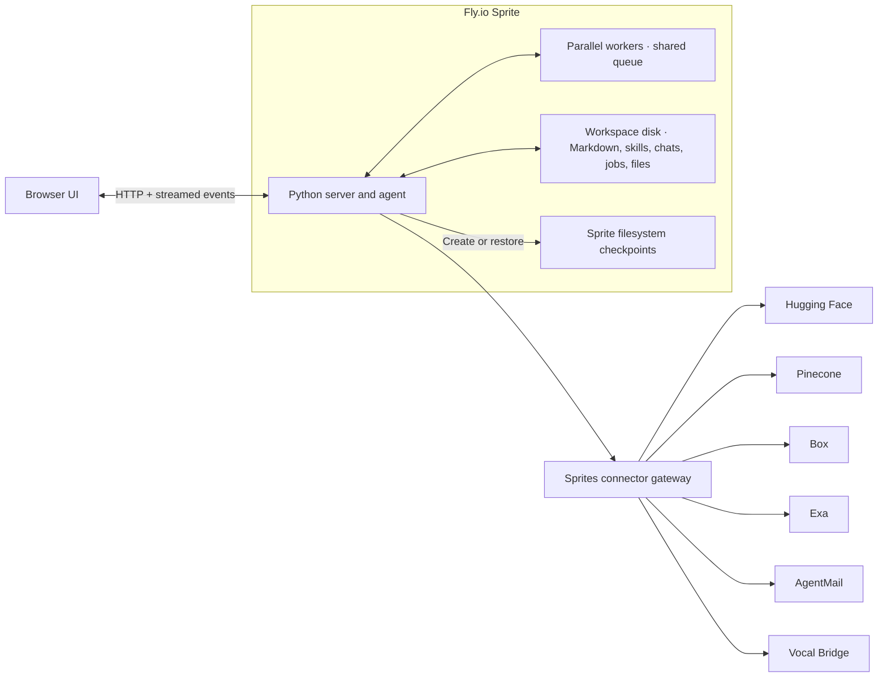

# Hearth


Hearth is a personal agent that lives on a Fly.io Sprite. Ask Ember to plan dinner, and Hearth can recall your Markdown notes, draft an invitation for approval, make a shopping spreadsheet, and schedule a reminder. The workspace stays on the Sprite across sleeps and restarts. Fly's connector gateway supplies access to models and services such as Box and Pinecone, while Timeline shows what Hearth did and which changes you can undo. Built for Fly.io Hacksgiving 2026.

## Screenshots

| Home | Chat approval | Artifacts and Pages |
| --- | --- | --- |
| [](docs/screenshots/home.png) | [](docs/screenshots/chat-approval.png) | [](docs/screenshots/artifacts-pages.png) |
| **Recurring tasks** | **Connections** | |
| [](docs/screenshots/recurring-tasks.png) | [](docs/screenshots/connections.png) | |

[](docs/screenshots/mobile-dark-drawer.png)

## What you can do

- **Chat with Ember.** Stream replies in Main or in separate side chats. Attach images, audio, PDFs, spreadsheets, and other supported files. Use a connected model, Smart routing across a model pool, or the local Mock brain.
- **Delegate independent work.** Ask a connected brain to use parallel workers for a comparison or several sources. Hearth shows progress, tool steps, and Stop controls in chat, shows active workers under **Running now** on Home, and combines their findings into one reply. Set the workspace limit from 1 to 6 in **Settings → Brain → Parallel workers**. The default is 4.
- **Get timely suggestions.** A connected brain can put offers in **Home → For you** after a memory change, new forwarded mail, or a scheduled check. Choose **Do it** to start a side chat, snooze or dismiss a card, or mute its category. [Proactivity guide](docs/proactivity.md)
- **Stay on top of work.** Home shows reminders, Inbox, recent files, memory, activity, connector health, and Open-Meteo weather. Add panels from chat and rearrange them on Home.
- **Make files and pages.** Create and edit DOCX, PDF, XLSX, and PPTX from chat. Preview and download artifacts, keep versions locally, and sync to Box. Build single-file HTML pages with phone and desktop previews, version history, and optional approved snapshot sharing.
- **Reuse skills in chat.** Start with four built-in Markdown playbooks or write your own. Use **Try it** to preload a skill in a side chat, see which skill Hearth loaded, and undo edits from Timeline. [Skills guide](docs/skills.md)
- **Review actions.** Approve, edit supported fields, or decline proposed actions, including email. Timeline records tool activity and approvals. Supported changes offer item-level Undo or filesystem checkpoint restore.
- **Review what Hearth remembers.** Edit your profile and browse linked People, Places, Topics, and Daily notes. Search uses keyword and optional Pinecone recall. With Auto-remember enabled, chat can save durable facts to subject notes during the turn. [Memory guide](docs/memory.md)
- **Run on a schedule.** Create reminders or recurring prompts with their own run history. AgentMail can import forwarded mail as proposals and deliver configured reminder or task email.
- **Talk to Hearth.** Dictate with browser speech recognition or Hugging Face Whisper. Vocal Bridge adds live calls routed to the originating chat, with a scripted call demo available locally.

## Architecture



## Sprites connectors used

Connectors are enabled per Sprite. A fresh clone has empty connection settings and runs with Mock when no model is available.

| Connector | What it powers | Status |
| --- | --- | --- |
| Hugging Face | Chat, image understanding, Whisper, and dense memory embeddings | Supported. Select a model under **Settings → Brain**. |
| Pinecone | Semantic recall, namespace sync, and optional reranking | Supported. Set up the index before syncing. Hearth falls back to local recall when Pinecone is unavailable. |
| Box | Artifact upload, version writes, and reading files from the workspace folder | Supported. Box version history uses local receipts until the gateway supports `GET /2.0/files/{file_id}/versions` (the `GET /versions` route). |
| Exa | Web search and source links in chat | Supported. Choose Exa under **Settings → Search**. |
| AgentMail | Approved chat email, reminder and task delivery, and forwarded-mail imports | Supported. Select or provision an inbox in **Connections**. |
| Vocal Bridge | Live calls and chat queries from the voice agent | Supported. Requires a deployed voice agent and its connector. |
| Browserbase | Search, fetch, and approval-gated browser sessions | Connected. Hearth allows two live sessions at a time. |
| Ollama Cloud | Alternative chat brain through the gateway | Optional. Select it in **Settings → Brain** after connecting. |

[Set up connectors](docs/connectors.md)

## Quick start

Use Python 3.12, the version pinned in CI. Run from the repository root.

```sh
python3 -m venv .venv
. .venv/bin/activate
python -m pip install -r requirements.txt
python -m hearth.server
```

Open <http://127.0.0.1:8080>. A fresh local workspace seeds the sample memory and falls back to Mock. You can also pin **Mock** in **Settings → Brain**. In Chat, select **Plan Thanksgiving dinner** to try recall, approvals, reminders, and file creation. The weather card can still contact Open-Meteo in Mock mode.

To deploy, sign in with the Sprites CLI, create a private Sprite named `hearth`, and run the deploy script.

```sh
scripts/deploy.sh
```

The [GitHub Actions workflow](.github/workflows/deploy.yml) runs the tests first and deploys when the repository secret `SPRITES_TOKEN` is set. See the [deployment guide](docs/deploy.md) for organization selection, scheduler wake, and the optional Pages publisher.

## Configuration

Use **Connections** to refresh discovery and **Settings** to configure the brain, recall, search, voice, reminders, proactivity, approvals, and artifacts. Recurring tasks can delegate through the same pool. A skill can delegate by including `spawn_workers` and the worker tools it allows. [Connector defaults](config/connectors.json) ship with blank connection IDs. Local settings are saved under the workspace by default. The Sprite service saves connector settings under `~/hearth/config/`.

| Setting | Use |
| --- | --- |
| `HEARTH_DATA_DIR` | Workspace root, defaulting to `.hearth/` locally. |
| `HEARTH_CONNECTOR_CONFIG` | Path to a private connector settings JSON file. |
| `HEARTH_CHECKPOINTS=sprite` | Select native checkpoints inside a Sprite. Local copies are the default. |
| `HEARTH_CJK_FONT` | Path to the WenQuanYi Micro Hei font for Chinese PDF text. |

## Tests

Use Node.js 22 as in CI. Install the Chinese PDF test font using the [development guide](docs/development.md), which also covers Playwright.

```sh
python -m pip install -r requirements-test.txt
python -m unittest discover -s tests
node --test tests/*.test.mjs
for file in web/*.js; do node --check "$file" || exit; done
```

The [QA report](QA-REPORT.md) includes a 90-second demo.

## Project layout

| Path | Contents |
| --- | --- |
| [hearth/](hearth/) | Python server, agent tools, provider adapters, and workspace services |
| [web/](web/) | HTML, CSS, JavaScript, Ember assets, and the vendored call SDK |
| [memory/](memory/) | Sample Markdown copied into a fresh workspace |
| [config/](config/) | Connector defaults and catalog |
| [scripts/](scripts/) | Sprite deployment, services, and scheduler wake |
| [tests/](tests/) | Python, Node, and browser fixtures |

## Security and privacy

Keep the workspace URL behind Sprite authentication. Provider API keys stay with Fly and are injected by the connector gateway. The repository ships blank connection settings and ignores runtime settings and data. Hearth persists chat, memory, skills, files, approvals, and schedules on disk. Enabled providers can receive prompts, loaded playbooks, excerpts, files, or audio required for the feature. Vocal Bridge sends the browser a short-lived room credential, and an approved public Page link grants anyone holding it access to that snapshot. A filesystem restore rolls back disk state. Delivered mail and other provider-side effects can persist after an Undo.

## Documentation

- [Architecture](docs/architecture.md)
- [Connectors](docs/connectors.md)
- [Deploy](docs/deploy.md)
- [Approvals and tasks](docs/approvals-and-tasks.md)
- [Proactivity and the Morning brief](docs/proactivity.md)
- [Memory](docs/memory.md)
- [Skills](docs/skills.md)
- [Voice](docs/voice.md)
- [Development](docs/development.md)
- [Project status](STATUS.md) and [QA report](QA-REPORT.md)

## License

Hearth is released under the [MIT License](LICENSE). The vendored call SDK and LiveKit code retain their Apache 2.0 notices. [Vocal Bridge license](web/vendor/LICENSE-VocalBridge), [LiveKit license](web/vendor/LICENSE-LiveKit)
